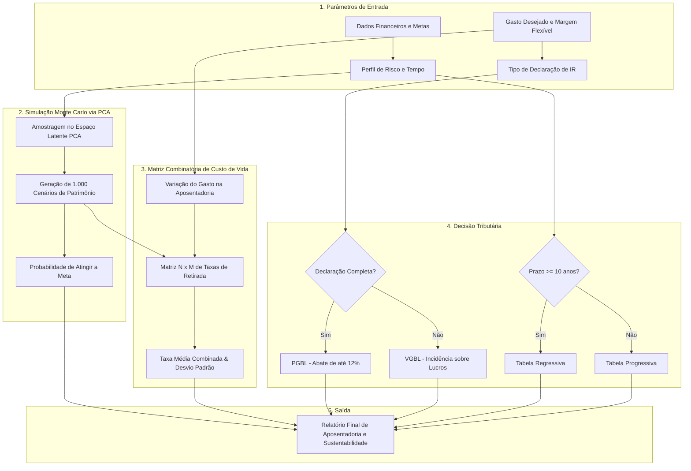

# Documento Modulo Executor De Multiplas Buscas

O script `1_Executar_Multiplas_Buscas_Google_Jobs.py` é o componente de controle central que permite executar buscas em lote. Ele automatiza a chamada do raspador para múltiplas palavras-chave consecutivas, gerenciando intervalos de espera para evitar bloqueios.

---

##  Fluxograma do Recomendador de Aposentadoria

O fluxograma a seguir ilustra a jornada de execução do sistema: desde a coleta dos dados do usuário até o cálculo de simulação estocástica por PCA e a definição do melhor produto tributário.



## Visão Geral e Finalidade

Dá a probabilida da pessoa conseguir consumir o produto de aposentadoria privada

---


## Conceitos

### A Simulação de Monte Carlo
A Simulação de Monte Carlo é uma técnica matemática e computacional que usa amostragem aleatória repetida para prever a probabilidade de diferentes resultados em um evento sujeito à incerteza

---

## Bilioteca

- **import numpy**: Permite a utilização de artifícios matemáticos relacionados a funções, sendo importante para gerar simulações e análises probabilísticas mais refinadas.
  * **Geração de Distribuições de Probabilidade**: Permite simular milhares de cenários estocásticos (distribuição normal `np.random.normal`, log-normal, binomial, uniforme, etc.) de forma simples e rápida.
  * **Operações Vetorizadas de Alta Performance**: Permite realizar cálculos matemáticos simultâneos em grandes arrays/matrizes de dados sem a necessidade de loops `for` lentos em Python nativo.
  * **Funções Estatísticas e Agregações**: Disponibiliza ferramentas prontas para calcular médias (`np.mean`), mediana (`np.median`), desvio padrão (`np.std`), percentis (`np.percentile`) e matrizes de covariância/correlação.

- **import dataclasses**: Permite criar perfis e estruturas de dados como formulários (data classes), evitando repetição de código.
  * **Organização e Modelagem**: Utilizado para definir o objeto `PerfilInvestidor` e estruturar os dados de entrada da função `simular_cenarios_pca`.
  * **Legibilidade**: Torna o código mais limpo, legível e intuitivo do ponto de vista conceitual.
  * **fastapi**: Serve para enviar requisições
  * **uvicorn**: Serve pare receber as requisições
  * **pydantic**: 
    * **Definição 1**: Verifica se os números retornados são válidos. 
    * **Definição 2**: O Pydantic é uma ferramenta utilizada para validação de dados em Python
  * **SQLAlchemy**: 
    * **Definição 1**:Permite rodar consultas SQL
  * **psycopg2**: É uma biblioteca que permite adaptar consultas sql a linguagem python de forma segura e eficaz.
  * **python-dotenv**: Armazena configurações da arquitetura e as c automaticamente.rregas.
  
  

---
## COMPONENTES

O sistema é estruturado de forma modular em Python, utilizando bibliotecas de alta performance para modelagem de dados, simulação probabilística e manipulação matemática.

### 1. Dependências e Módulos Principais
* **`dataclasses` (`PerfilInvestidor`)**: Utilizado para encapsular os parâmetros do investidor (renda, aportes, patrimonio atual, metas, tolerância a risco e regras de IR). Atua como a estrutura central de entrada de dados, garantindo tipagem clara e legibilidade.
* **`numpy`**: Responsável por toda a camada de cálculo matricial, vetorização e estatística:
  * **`np.random.normal`**: Gera as amostragem estocásticas no espaço latente PCA.
  * **`np.linspace`**: Cria as variações contínuas de custo de vida na aposentadoria (margem flexível de gasto).
  * **`np.mean` / `np.std` / `np.percentile`**: Calcula métricas de tendência central, desvio padrão e cenários de percentis (P10 pessimista, P50 mediano e P90 otimista).
* **`math`**: Fornece operações aritméticas básicas e funções de conversão para taxas equivalentes mensais e anuais.
* **`typing.Dict` / `typing.Any`**: Define contratos explícitos de retorno das funções do recomendador.

### 2. Funções do Core Financeiro
* **`simular_cenarios_pca(...)`**: Executa a simulação estocástica no espaço latente e a análise combinatória de custos de vida.
* **Geração de Dados e Reprodutibilidade (`np.random.seed`)**: 
  A função `np.random.seed(seed)` fixa a semente pseudoaleatória do NumPy, garantindo a reprodutibilidade determinística da simulação (com a *seed* 42, qualquer execução com os mesmos parâmetros gerará exatamente os mesmos 1.000 cenários estocásticos). A partir dessa semente, o modelo amostra cenários probabilísticos coerentes com o perfil do investidor e o horizonte temporal em meses (`anos_ate_aposentadoria * 12`).

```python
def simular_cenarios_pca(
    perfil: PerfilInvestidor,
    retorno_base: float,
    volatilidade_base: float,
    n_simulacoes: int = 1000,
    seed: int = 42
) -> Dict[str, Any]:
    np.random.seed(seed)
    meses = perfil.anos_ate_aposentadoria * 12
```


* **`pca_x_profissional = np.random.normal(loc=0.0, scale=0.15, size=n_simulacoes)`**: 
  Simula a variabilidade estocástica ao longo do eixo $X$ do espaço latente PCA. No contexto da modelagem, representa as oscilações no mercado de trabalho e na trajetória profissional do investidor, impactando diretamente o fator de ajuste do aporte mensal (capacidade de poupança/renda).

* **`pca_y_mercado = np.random.normal(loc=0.0, scale=volatilidade_base, size=n_simulacoes)`**: 
  Simula a variabilidade estocástica ao longo do eixo $Y$ do espaço latente PCA. Representa os cenários macroeconômicos e as oscilações do mercado financeiro, impactando a taxa de retorno real anual acumulada com base na volatilidade do perfil de risco selecionado (`conservador`, `moderado` ou `arrojado`). 

* **`recomendar_aposentadoria(...)`**: Processa a árvore de decisão fiscal/tributária e consolida a recomendação final de produto.
* **patrimonios_finais**: Vai armazenar os valores de cada simulação

* **for i in range(n_simulacoes):** 
    * **fator_aporte = max(0.5, 1.0 + pca_x_profissional[i])**: Calcula o multiplicador da capacidade de aporte para o cenário atual, aplicando um piso mínimo de 0.5 (50%) para evitar que oscilações negativas extremas gerem aportes irreais ou negativos.
    * **aporte_simulado = perfil.aporte_mensal * fator_aporte**: Define o valor efetivo que será investido por mês nessa simulação, através de um valor razoável com base nas oscil.ações
    * **retorno_anual_simulado = max(0.01, retorno_base + pca_y_mercado[i])**: Calcula um multiplicador que retorna o valor que o dinheiro produzirá como investimento, esse multipl leva em consideração as oscilações do mercado.
    * **r_mensal = (1 + retorno_anual_simulado) ** (1 / 12) - 1**: Esse é o quanto a aposentadoria renderia em um cenário comum, com basen as simulações e oscilações.
    * **fv_patrimonio = perfil.patrimonio_atual * ((1 + r_mensal) ** meses)**: É o valor do patrimônio total, após o período do investimento.
    * **fv_aportes = aporte_simulado * (((1 + r_mensal) ** meses - 1) / r_mensal)**: Calcula o montante acumulado exclusivamente pelos novos aportes mensais feitos ao longo dos meses, somados aos juros compostos gerados por eles.

    * **patrimonio_final = fv_patrimonio + fv_aportes**: Soma o rendimento do patrimônio inicial com o total acumulado dos aportes mensais, resultando no saldo total da aposentadoria nesse cenário.
    * **patrimonios_finais.append(patrimonio_final)**: Guarda o valor final calculado nesta simulação dentro de uma lista para analisar todos os cenários juntos no final.
    * **if patrimonio_final >= perfil.meta_patrimonio: sucessos += 1**: Verifica se o saldo acumulado atingiu ou superou o objetivo definido pelo usuário; se sim, contabiliza mais um cenário bem-sucedido para calcular a probabilidade de sucesso.
* **patrimonios_finais = np.array(patrimonios_finais)**: Calcula todas as possíveis quantias de patrimonios finais com base em oscilações.
* **probabilidade_sucesso = (sucessos / n_simulacoes) * 100**: Calcula a probabilidade das probabilidade, resultando em um único percentual que indica a chance de atingir a meta estabelecida.
* **TETO_ISENCAO_SIMPLIFICADA_ANUAL = 85000.0**: O PGBL só compensa se esses 15% abstidos do imposto de renda forem muito grandes, caso contário o VGBL ganha maior vantagem, pois o lucro já tem o imposto descontado.
    * **Vale a pena PGBL**: Quando a pessoa tem renda tributável alta (CLT, servidor público, etc.), já utiliza o modelo Completo por ter outros gastos dedutíveis altos (filhos, plano de saúde, escola, previdência oficial) e vai reinvestir a restituição de IR que ganhar todo ano.

    * **Vale a pena VGBL**: Quando a pessoa declara no modelo Simplificado, é isenta, é autônoma/MEI com pouca renda tributável ou quer investir acima dos 12% da renda bruta (o excedente acima de 12% nunca deve ir para o PGBL, e sim para o VGBL).
* **if perfil.declara_ir_completo and renda_anual > TETO_ISENCAO_SIMPLIFICADA_ANUAL:[...]else[...]**: A previdência vai ser do tipo PGBL, caso a renda anual dele for maior que o teto. Caso contrário o investidor se encaixa no perfil VGBL.
* **gasto_alvo_anual = perfil.gasto_mensal_aposentadoria * 12**: Verifica o custo anual de vida do usuário.
* **margem = perfil.margem_gasto_percentual**: Quantifica o quanto o usuário pode gastar através de um número que serve como margem.
* **cenarios_gastos_anuais = np.linspace[...]**: Cria um array com 5 cenários de gasto anual igualmente espaçados, partindo do limite mínimo possível (gasto alvo menos a margem) até o limite máximo (gasto alvo mais a margem), representando 5 níveis distintos de custo de vida na aposentadoria.

* **todas_as_taxas = np.array(todas_as_taxas)**: Para ter o número mais aproximado da realidade, pegamos s "margens" para poder testar o máximo de cenários possíveis.

**taxa_retirada_media_combinada = np.mean(todas_as_taxas):** A média aritmética de todas as margens de gasto, seria uma margem mais verosemelhante.

* **desvio_padrao_taxa = np.std(todas_as_taxas):** Calcula o desvio padrão das taxas de retirada, medindo o grau de dispersão ou risco de variação em torno da média.

* **taxa_retirada_mediana = np.median(todas_as_taxas):** Encontra o valor central (percentil 50) das taxas de retirada, oferecendo uma métrica menos sensível a cenários extremos (muito otimistas ou muito pessimistas).

* **return { ... }**: Consolida e retorna um dicionário com os resultados finais da simulação arredondados para duas casas decimais, incluindo a verificação booleana "sustentavel", que valida se a taxa média de retirada anual é menor ou igual ao retorno base esperado da carteira (garantindo que o patrimônio não se esgote ao longo do temphas:

    * **`"probabilidade_sucesso": round(probabilidade_sucesso, 2)`**: Probabilidade percentual de o investimento atingir ou superar a meta estabelecida.
    * **`"patrimonio_mediano_p50": round(np.median(patrimonios_finais), 2)`**: O valor central (mediana) do patrimônio projetado ao final do período, considerando todas as simu    lações.
    * **`"margem_gasto_analisada": f"±{int(margem * 100)}%"`**: A faixa percentual de variação (para mais ou para menos) aplicada sobre o gasto desejado na aposentadoria.
    * **`"gasto_mensal_minimo": round((gasto_alvo_anual * (1 - margem)) / 12, 2)`**: O valor **mensal** mínimo de gasto que o usuário pode exercer dentro da margem de flexibilidade.
    * **`"gasto_mensal_maximo": round((gasto_alvo_anual * (1 + margem)) / 12, 2)`**: O valor **mensal** máximo de gasto que o usuário pode exercer dentro da margem de flexibilidade.
    * **`"taxa_retirada_media_combinada": round(taxa_retirada_media_combinada, 2)`**: O percentual médio do patrimônio acumulado que será retirado **por ano** para cobrir os gastos.
    * **`"taxa_retirada_mediana": round(taxa_retirada_mediana, 2)`**: O valor central (mediana) do percentual de retirada anual, ignorando distorções de cenários extremos.
    * **`"desvio_padrao_taxa": round(desvio_padrao_taxa, 2)`**: O grau de variação (risco) das taxas de retirada em relação à média.
    * **`"sustentavel": taxa_retirada_media_combinada <= (retorno_base * 100)`**: Indica (`True` ou `False`) se o plano é sustentável, verificando se a retirada média anual não ultrapassa o rendimento esperado da carteira.

    def recomendar_aposentadoria(perfil: PerfilInvestidor) -> Dict[str, Any]: Função principal que consolida os parâmetros de risco, executa a simulação estocástica e define a melhor estratégia tributária de previdência privada para o perfil.

* **recomendar_aposentadoria(perfil: PerfilInvestidor) -> Dict[str, Any]**: Essa função vai retornar um dicionário com a recomendação de aposentadoria, ou seja, o melhor plano tributário (PGBL ou VGBL), a melhor tabela de tributação (Regressiva ou Progressiva) e os resultados consolidados da simulação.

    * **renda_anual = perfil.renda_bruta_mensal * 13**: Calcula a renda bruta total no ano considerando os 12 meses mais o 13º salário.

    * **parametros_perfil = { ... }**: Aqui temos tipo um "switch" para saber em qual perfil o usuário se encaixa, com base nos dados fornecidos

    * **plano_recomendado, tributacao_nota = _definir_estrategia_tributaria(perfil, renda_anual)**: Vai ativar a função que verifica se o perfil do usuário é voltado para um aposentadoria já isenta(VGBL) ou a que incide nos impostos.
    
    * **Perfil calculador**: Com base na análise o sistema retornará o plano recomendado, renda anual, tipo de perfil, 
  
    * **"renda_anual": renda_anual**: Valor total da renda bruta anual calculada (considerando os 12 meses mais o 13º salário).

    * **"perfil_calculado"**: tolerancia: Classificação de tolerância ao risco (conservador, moderado ou arrojado) definida automaticamente pela flexibilidade de gastos do usuário.

    * **"plano_recomendado"**: plano_recomendado: Combinação final da modalidade de previdência privada e do regime de tributação mais vantajosos (ex.: PGBL (Regressiva) ou VGBL (Progressiva)).

    * **"tributacao_nota"**: tributacao_nota: Orientação fiscal personalizada explicando o motivo da escolha do plano e, quando aplicável, o teto mensal ideal para dedução no IRPF.

    * **"simulacao_pca"**: simulacao: Dicionário completo contendo todas as métricas probabilísticas e de sustentabilidade geradas pela simulação de Monte Carlo.

    
---

## FUNCIONAMENTO

O funcionamento do sistema divide-se em quatro fases encadeadas: da coleta de parâmetros à recomendação fiscal.

```mermaid
flowchart TD
    subgraph F1[Fase 1: Entrada de Dados]
        A[PerfilInvestidor] --> B[Parâmetros Macroeconômicos]
    end

    subgraph F2[Fase 2: Monte Carlo via PCA]
        B --> C[Espaço Latente PC1 x PC2]
        C --> D[1.000 Cenários de Patrimônio Accumulado]
    end

    subgraph F3[Fase 3: Matriz Combinatória]
        D --> E[Variação de Custos de Vida ±Margem]
        E --> F[Matriz N x M de Taxas de Retirada]
    end

    subgraph F4[Fase 4: Decisão Fiscal & Recomendação]
        F --> G{Declaração Completa IRPF?}
        G -- Sim --> H[PGBL - Abate de até 12%]
        G -- Não --> I[VGBL - Incidência sobre Lucros]
        H & I --> J[Regra Regressiva vs Progressiva]
        J --> K[Diagnóstico de Sustentabilidade & Relatório]
    end