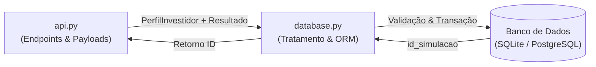

# Introdução (`database.py`)

* **Definição**: A camada de persistência é responsável pela configuração do banco de dados relacional, mapeamento objeto-relacional (ORM) via **SQLAlchemy** e armazenamento transacional dos perfis de investidores e resultados das simulações de aposentadoria.
* **Definição 2**: Camada responsável por armazenar e tratar o dados que serão enviados pela api.py

---

## Bilioteca
  * **os**: Roda operações nativas do sistema através de código python.
  * **datetime**: Permite manipular dados referente ao tempo
  * **typing**: Aumenta a compatibilidade do alfabeto, letras. Como a capacidade do "ç" e coisas parecidas.
  * **src.domain**: Pega a fórmula da classe para usar efetivamente
  * **pydantic**: 
    * **Definição 1**: Verifica se os números retornados são válidos. 
    * **Definição 2**: O Pydantic é uma ferramenta utilizada para validação de dados em Python
  * **SQLAlchemy**: 
    * **Definição 1**:Permite rodar consultas SQL
  
---
## Fluxo de Dados (`api.py` $\rightarrow$ `database.py`)



## COMPONENTES


### 0. Conexão Com o Banco de Dados
* **DATABASE_URL = os.getenv("DATABASE_URL", "sqlite:///./aposentadoria.db")**: Esse é como se fosse o endereço de onde os dados vão ir, isso permite que os dados tenham o lugar para onde vão.
* **connect_args = {"check_same_thread": False} if DATABASE_URL.startswith("sqlite") else {}`**: 
    * **Definição 1:** O SQLite, por padrão, possui uma trava de segurança (`check_same_thread=True`) que proíbe que uma conexão criada em uma *thread* seja reutilizada por outra *thread* diferente (para evitar corrupção de dados simultâneos). Em APIs web como o FastAPI, cada requisição HTTP pode ser processada em uma *thread* diferente do *pool* de execução. Se o SQLite mantiver a trava padrão, o Python lançará um erro.
    * **Definição 2:** Libera a trava de segurança do SQLite para que várias requisições da API possam usar a conexão ao mesmo tempo sem travar ou gerar erro de concorrência, aplicando essa regra apenas quando o banco for SQLite.

    !!! note "O que é uma Thread?"
        Uma *thread* é uma linha de execução independente dentro de um **mesmo processo** (programa). Em vez de abrir uma cópia inteira da aplicação para cada usuário, o servidor cria várias *threads* que compartilham a mesma memória para processar requisições simultâneas.
* **engine = create_engine(DATABASE_URL, connect_args=connect_args)**:
    * **Definição 1:** Instancia o motor de conexão central (*Engine*) do SQLAlchemy, configurando o dialeto do banco de dados a partir da `DATABASE_URL`, o gerenciador de *pool* de conexões e os argumentos específicos de baixo nível (`connect_args`). Ele atua como a fábrica de conexões que traduz comandos Python/ORM para o driver do banco físico.
    * **Definição 2:** Cria a "ponte" principal de comunicação entre o código Python e o banco de dados, aplicando o endereço do banco e as regras de conexão definidas anteriormente.
* **engine = create_engine(DATABASE_URL, connect_args=connect_args)**: **`engine = create_engine(DATABASE_URL, connect_args=connect_args)`**: Define os procedimentos padrões para o uso da API, é o ponto inicial da aplicação para realizar os comandos referentes à API, como se fosse uma engrenagem.
    * **Definição 1:** Instancia o motor de conexão central (*Engine*) do SQLAlchemy, configurando o dialeto do banco de dados a partir da `DATABASE_URL`, o gerenciador de *pool* de conexões e os argumentos específicos de baixo nível (`connect_args`). Ele atua como a fábrica de conexões que traduz comandos Python/ORM para o driver do banco físico.
    * **Definição 2:** Cria a "ponte" principal de comunicação entre o código Python e o banco de dados, aplicando o endereço do banco e as regras de conexão definidas anteriormente.
- **SessionLocal = sessionmaker(autocommit=False, autoflush=False, bind=engine)**:
  * **Definição 1**: Atribui uma fábrica de sessões para abrir conexões temporárias e realizar as requisições/operações no banco de dados com segurança.
  * **Definição 2**: Configura uma fábrica de sessões transacionais (`Session`) do SQLAlchemy vinculada ao motor do banco (`bind=engine`), desativando o salvamento automático (`autocommit=False`) e o envio prematuro de alterações (`autoflush=False`) para garantir que os dados só sejam gravados de fato quando houver um `db.commit()` explícito (evitando registros pela metade em caso de erro).
  * **Definição 3**: Atribui uma sessão para realizar as requisições.

### 1. Como O Envio É Preparado
- * **A classe PerfilModel(Base)**: 
    * **Definição 1**: Esse é o molde, é necessário ter a estrutura do molde para ter a estrutura tipo JSON para armazenar da forma correta o registro.
    * **Definição 2**: Modelo ORM (*Object-Relational Mapping*) declarativo do SQLAlchemy que herda de `Base`, mapeando a classe Python diretamente para a tabela relacional `perfil`, definindo suas colunas, tipos de dados (`Numeric`, `Integer`, `Boolean`), valores padrão, relacionamentos (`relationship`) e restrições de integridade (`CheckConstraint`).

- **simulacoes = relationship("SimulacaoResultadoModel", back_populates="usuario", cascade="all, delete-orphan")**:
  * **Definição 1**: Estabelece uma relação entre o banco portador e o banco que vai enviar
  * **Definição 2**: Define um relacionamento bidirecional ORM (*One-to-Many*) no SQLAlchemy entre `PerfilModel` e `SimulacaoResultadoModel`:
    * **`"SimulacaoResultadoModel"`**: É necessário a ficha para poder ter o molde e enviar os dados.
    * **`back_populates="usuario"`**: Sincroniza os dois lados da relação em memória (ao adicionar uma simulação em `usuario.simulacoes`, o atributo `simulacao.usuario` é preenchido automaticamente).
    * **`cascade="all, delete-orphan"`**: Ele propaga a ação de save-update, merge. Ou seja, ele salva, atualiza e substitui informações.

- **__table_args__**: Vai realizar a checagem das informações, se elas estão no conjunto correto de valores.

- **A classe `SimulacaoResultadoModel(Base)`**:
  * **Definição 1**: É o "molde" da tabela de histórico (`simulacoes_resultados`) que guarda as respostas e diagnósticos gerados pelo motor de cálculo, mantendo um registro auditável de cada simulação feita para um usuário.
  * **Definição 2**: Modelo ORM (*Object-Relational Mapping*) declarativo do SQLAlchemy que mapeia a entidade de resultados estocásticos para a tabela relacional `simulacoes_resultados`, estabelecendo integridade referencial com `PerfilModel`.

### 2. Como O Envio É Feito

- **salvar_simulacao(perfil: PerfilInvestidor, resultado: Dict[str, Any]) -> int**

    * **Definição 1**: É o "contrato" de entrada e saída da função: avisa que ela exige receber um dicionário com chaves em texto e valores variados (resultado) e promete devolver um número inteiro (int), que é o ID da simulação salva no banco.

    * **Definição 2**: Anotações de tipo estático (Type Hints) do módulo typing que especificam a estrutura do mapeamento de entrada (Dict[str, Any]) e o tipo escalar de retorno (int), melhorando a legibilidade, a documentação automática e a detecção preventiva de erros na IDE.

    * **Definição 3**: É uma função que recebe o formulário do usuário (`perfil`) e um dicionário (`resultado`) contendo chaves em `str` (os campos da resposta da simulação) com valores de qualquer tipo (`Any`), e que deve retornar obrigatoriamente um valor inteiro (`int`), correspondente ao ID gerado no banco.

- **sim = resultado["simulacao"]**:
    * **Definição 1**:atribui o perfil a um espaço de memória do computador

- **with SessionLocal() as db**: Com a sessão ativa será atribuido um novo perfil e os dados serão carregados para dentro desse perfil
- **db.add(novo_perfil)**: Os dados são adicionados
- **db.flush()**:
  * **Definição 1**: Envia as alterações pendentes para o banco de dados em "modo rascunho" (sem confirmar o salvamento definitivo ainda) apenas para que o banco gere e devolva o ID automático do perfil (`id_usuario`), permitindo amarrar o resultado da simulação ao dono certo antes de fechar a transação.
  * **Definição 2**: Sincroniza o estado em memória da sessão do SQLAlchemy com o banco de dados emitindo os comandos SQL (`INSERT`) dentro da transação ativa sem executar `COMMIT`, populando as chaves primárias autoincrementadas (`autoincrement=True`) e mantendo a possibilidade de `ROLLBACK` atômico caso ocorra erro nas etapas seguintes.
- **nova_simulacao = SimulacaoResultadoModel**: Essa é a variável com a ficha já calculada, é o que deve ser retornado ao usuário.
- **db.add(nova_simulacao)**: Adiciona essas informações no db
- **db.commit()**: Confirma o envio dessa informação, da ficha no caso.
- **db.refresh(nova_simulacao)**: Atualiza o banco de dados para novas informações serem adicionadas.
- **return nova_simulacao.id_simulacao**: Retorna a ficha gerada.


---

## Diagrama Entidade-Relacionamento (DER)

O banco possui um relacionamento **1:N** (um para muitos) entre usuários (`perfil`) e suas execuções de simulação (`simulacoes_resultados`), com exclusão em cascata (`ON DELETE CASCADE`).

```mermaid
erDiagram
    PERFIL ||--o{ SIMULACOES_RESULTADOS : "possui"

    PERFIL {
        int id_usuario PK "Auto-incremento"
        numeric renda_bruta_mensal "Numeric(12,2), >= 0"
        numeric gasto_mensal_aposentadoria "Numeric(12,2), > 0"
        numeric margem_gasto_percentual "Numeric(5,4), >= 0"
        numeric aporte_mensal "Numeric(12,2), >= 0"
        numeric patrimonio_atual "Numeric(14,2), >= 0"
        numeric meta_patrimonio "Numeric(14,2), > 0"
        boolean declara_ir_completo "Default: False"
        int anos_ate_aposentadoria "Integer, > 0"
        datetime criado_em "UTC Timestamp"
    }

    SIMULACOES_RESULTADOS {
        int id_simulacao PK "Auto-incremento"
        int id_usuario FK "Ref: perfil.id_usuario"
        string perfil_risco_calculado "Varchar(20)"
        string plano_recomendado "Varchar(50)"
        numeric probabilidade_sucesso "Numeric(5,2)"
        numeric patrimonio_p10 "Numeric(16,2)"
        numeric patrimonio_mediano_p50 "Numeric(16,2)"
        numeric patrimonio_p90 "Numeric(16,2)"
        numeric taxa_retirada_media "Numeric(6,2)"
        boolean sustentavel "Indicador de viabilidade"
        datetime executado_em "UTC Timestamp"
    }